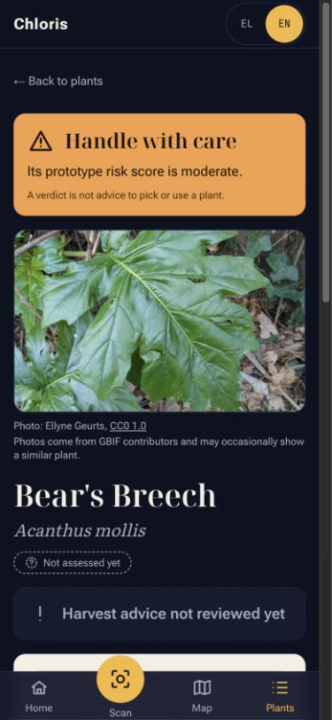

# Chloris

> Explore where Greece's medicinal-use plants have been recorded, which may be at risk, and what we still do not know.

**EthnoHack 2026 · Track 3: Biodiversity & Sustainability**

[Live demo](https://makeathon-2026-chloris-biodiversity.vercel.app/) · [Pitch video script](docs/PITCH_VIDEO_SCRIPT.md) · [Method and limitations](#method-and-limitations)



Chloris is a bilingual, mobile-friendly web prototype about plants **native to Greece** that have a medicinal-use flag in Kew's World Checklist of Useful Plant Species (WCUPS). That flag covers human **or veterinary** medicine anywhere in the world. It does not establish use in Greece, efficacy, or safety.

## What you can try

- **Explore** a searchable catalogue of 1,386 species, occupied map cells and species pages with risk breakdowns, observation history, data-quality notes and credited photos.
- **Scan** a plant photo for ranked candidates from Pl@ntNet. Live identification needs a connection and API key. Three clearly labelled cached example results are available for a reliable demo.
- **Record** a sighting on the current device. At-risk and unknown plants are rounded to a 0.1° grid before saving. Sightings do not sync between devices.
- **Switch** between Greek and English. Species without a confirmed Greek name retain their scientific name.

**Current release status:** The interface mentions installation and offline use, but this repository has no web app manifest or service worker. Browser “Add to Home Screen” may create a shortcut; reliable PWA installation and offline access are **not implemented**. Firestore rules exist for a planned cloud sightings flow, while the current sightings UI uses IndexedDB only.

## Results in this build

Counts come from the committed [data export](web/public/data/meta.json), generated **7 November 2026**. They are not a census of Greece's living plants.

| Measure | Current export |
| --- | ---: |
| WCVP species native to Greece before the medicinal filter | 6,081 |
| Catalogue species with a WCUPS medicinal-use flag | 1,386 |
| Cleaned GBIF occurrence records used | 299,438 |
| Occupied 0.1° map cells | 2,134 |
| Species flagged at risk by the draft method | 4 |
| Catalogue species without an IUCN assessment | 1,036 |

The map marks **75 hotspot cells** under the draft rule in [`scoring.yaml`](pipeline/config/scoring.yaml). Neither a hotspot nor a score is a field-verified conservation assessment.

## How it works

```text
Kew WCVP + Kew WCUPS ──> Greek-native species with a medicinal-use flag
                                      │
GBIF taxonomy + observations + EEA Natura 2000 boundaries
                                      │
                        Python pipeline and draft score
                                      │
                   versioned JSON / GeoJSON in web/public/data
                                      │
                      Next.js web app and MapLibre map
                                      ├──> Pl@ntNet via /api/identify
                                      └──> device-only sightings in IndexedDB
```

The [pipeline](pipeline/chloris/) resolves accepted names and synonyms, cleans the GBIF download, aggregates observations into **0.1° cells** (roughly 10 km, varying with latitude) and joins them to Natura 2000 areas. [The notebook](pipeline/chloris_pipeline.ipynb) shows its steps and saved outputs. Coastal and island map flowers use representative land positions from [geoBoundaries](https://www.geoboundaries.org/api/current/gbOpen/GRC/ADM0/), not individual occurrence coordinates.

### Draft risk method

Each available component has a fraction from 0 to 1. Missing components are omitted and the remaining weights are rescaled:

$$S = 100\,\frac{\sum_{i\in A} w_i f_i}{\sum_{i\in A} w_i}$$

Here $A$ is the set of available components, $w_i$ a configured weight and $f_i$ the component fraction. The [v0-draft configuration](pipeline/config/scoring.yaml) awaits science-lead review; its weights and thresholds are **not scientifically validated**.

| Component | Configured weight | Signal |
| --- | ---: | --- |
| IUCN category via GBIF | 35 | Higher category severity adds points; “not assessed” remains distinct from “least concern.” |
| Greek endemism | 15 | WCVP native range limited to Greek areas. |
| Rarity | 15 | Fewer occupied 0.1° cells raises the signal. |
| Decline | 15 | 1950–1999 versus 2000 onward, corrected by total Greek plant-recording effort; needs at least 10 older records. |
| Outside Natura 2000 | 15 | Share of cleaned records outside protected areas. |
| Recent fire exposure | 5 | **Unavailable in this export**; its weight is removed and available weights are rescaled. |

The prototype flags a species at risk if its IUCN code is CR, EN or VU, or its draft score is at least 55. Harvest guidance and human-safety notes are separate limited reviews. An unreviewed plant is **not** presumed safe.

## Data, services and attribution

| Source | Use | Version and rights |
| --- | --- | --- |
| [Kew World Checklist of Vascular Plants](https://sftp.kew.org/pub/data-repositories/WCVP/) | Names, native ranges, synonyms and endemism | Files dated 4 June 2026, downloaded 4 November 2026; CC BY 3.0. |
| [Kew World Checklist of Useful Plant Species](https://doi.org/10.5063/F1CV4G34) | `ME` medicinal-use flag | Diazgranados et al. (2020), DOI [10.5063/F1CV4G34](https://doi.org/10.5063/F1CV4G34); CC BY 4.0. Extracted from a PDF; [extraction audit](pipeline/WCUPS_EXTRACTION.md). |
| [GBIF occurrence download](https://doi.org/10.15468/dl.g7nrxe) | Observations in Greece | Downloaded 4 November 2026; DOI [10.15468/dl.g7nrxe](https://doi.org/10.15468/dl.g7nrxe); licences vary by contributing record. |
| [GBIF species API](https://www.gbif.org/developer/species) | Taxon matching, common names and IUCN category exposed by GBIF | Queried November 2026; credit GBIF. |
| [EEA Natura 2000](https://www.eea.europa.eu/en/datahub/datahubitem-view/6fc8ad2d-195d-40f4-bdec-576e7d1268e4) | Protected-area boundaries | EEA / European Commission data, reused with attribution. |
| [geoBoundaries Greece ADM0](https://www.geoboundaries.org/api/current/gbOpen/GRC/ADM0/) | Land positions for map flowers | EuroGeoGraphics / Regional IM Working Group - Europe (2016); CC BY 4.0. |
| [OpenFreeMap](https://openfreemap.org/) and [OpenStreetMap](https://www.openstreetmap.org/copyright) | Base map | OpenFreeMap © OpenMapTiles; data © OpenStreetMap contributors. |
| [Mapzen / AWS Terrain Tiles](https://github.com/tilezen/joerd/blob/master/docs/attribution.md) | Optional relief | Terrain and elevation-source credits also appear in `/about`. |
| [Pl@ntNet identification API](https://my.plantnet.org/doc/api/identify) | Ranked photo candidates | Pl@ntNet's model, not trained by Chloris. |
| [GBIF](https://www.gbif.org/developer/occurrence), [iNaturalist](https://www.inaturalist.org/pages/api+recommended+practices) and [Wikimedia Commons](https://commons.wikimedia.org/) contributors | Species photos | Each displayed photo credits its creator and licence; see below. |
| [EMA herbal monographs](https://www.ema.europa.eu/en/human-regulatory-overview/herbal-medicinal-products), [NC State Extension](https://plants.ces.ncsu.edu/) and linked studies | Limited use and danger notes | Each curated entry links to its source. |

Main web libraries are [Next.js](https://github.com/vercel/next.js) and [React](https://github.com/facebook/react) (MIT), [MapLibre GL JS](https://github.com/maplibre/maplibre-gl-js) (BSD-3-Clause), [react-map-gl](https://github.com/visgl/react-map-gl) and [Three.js](https://github.com/mrdoob/three.js) (MIT), [idb-keyval](https://github.com/jakearchibald/idb-keyval) (Apache-2.0), and [qrcode.react](https://github.com/zpao/qrcode.react) (ISC). Versions and the remaining direct dependencies are in [`web/package.json`](web/package.json) and its lockfile; Python dependencies are in [`pipeline/requirements.txt`](pipeline/requirements.txt).

Greek names come from GBIF and exact-taxon corrections in [`greek_names.csv`](pipeline/config/greek_names.csv); no name is assigned to another plant just because it shares a genus.

### Photo licences and privacy

Species-page photos use **CC0** or **CC BY** still images with suitable human observations and a named creator where the licence requires one. Research-grade iNaturalist records are preferred. Herbarium specimens, NoDerivatives, ShareAlike and unlicensed images are excluded. **One explicit exception:** the *Galanthus ikariae* image by Thanasis Papanikolaou is **CC BY-NC 4.0** for this non-commercial prototype; replace or remove it before commercial use.

The app shows “Photo: creator, licence,” links the creator to the image and the licence to its terms. [The catalogue](web/public/data/photo-catalog.json) and `/api/photo/[slug]` store or return only `{ url, creator, licence, licenceUrl }`; GBIF occurrence coordinates and IDs are not exposed. A missing or failed photo shows a flower icon. Photos may show a similar plant and do not verify identification. Kew POWO image pages are linked for reference, not embedded.

To add a photo you own: remove its GPS/EXIF metadata, verify the species and your right to license it, save it under `web/public/photos/`, then add its four credit fields to the catalogue. Validate and build before committing.

## Run the web app

Requires Node.js compatible with the checked-in Next.js version and npm:

```bash
cd web
npm ci
cp .env.example .env.local
# Set PLANTNET_API_KEY for live identification.
# NEXT_PUBLIC_SITE_URL is optional locally; it controls the QR destination.
npm run dev
```

Open [http://localhost:3000](http://localhost:3000). Bundled sample results work without a Pl@ntNet key. Firebase fields in `.env.example` are reserved for future cloud sightings; the current UI saves on this device. Never commit `.env` files or prefix `PLANTNET_API_KEY` with `NEXT_PUBLIC_`.

```bash
cd web
npm run validate-data
npm run lint
npm run build
```

## Reproduce the data export

Raw source downloads and GBIF credentials are deliberately excluded from Git. The committed JSON works immediately; rebuilding it requires original source files and a GBIF account.

1. Create a Python 3.11+ environment in `pipeline/` and install [`requirements.txt`](pipeline/requirements.txt).
2. Place `wcvp_names.csv` and `wcvp_distribution.csv` from [Kew WCVP](https://sftp.kew.org/pub/data-repositories/WCVP/) under `pipeline/raw/wcvp/`. Place the [WCUPS PDF](https://doi.org/10.5063/F1CV4G34) at `pipeline/raw/wcups/data/World_Checklist_of_Useful_Plant_Species_2020.pdf`. Put [EEA Natura 2000 spatial data](https://www.eea.europa.eu/en/datahub/datahubitem-view/6fc8ad2d-195d-40f4-bdec-576e7d1268e4) in `pipeline/raw/natura2000/`.
3. Copy `pipeline/.env.example` to `pipeline/.env` and set `GBIF_USER`, `GBIF_PWD`, `GBIF_EMAIL` for a new download. Never commit credentials or `pipeline/raw/`.
4. Run the stages from `pipeline/`. Wait until the GBIF download is `SUCCEEDED` before cleaning.

```bash
cd pipeline
python3 -m venv .venv
source .venv/bin/activate
pip install -r requirements.txt
python -m chloris.run --step wcvp
python -m chloris.run --step wcups
python -m chloris.run --step gbif
python -m chloris.flags
python -m chloris.gbif request
python -m chloris.gbif poll     # repeat until SUCCEEDED
python -m chloris.gbif clean
python -m chloris.gbif effort
python -m chloris.run --step cells
python -m chloris.run --step protected
python -m chloris.run --step fire       # skips if fire data is absent
python -m chloris.run --step score
python -m chloris.run --step export
cd ..
pipeline/.venv/bin/python pipeline/build_land_anchors.py
cd web
npm run validate-data
npm run build
```

The notebook calls the same modules. `python -m chloris.run --step all` does **not** request, poll or clean the GBIF download or calculate effort totals; perform those subcommands first. Newer source snapshots may change the counts.

## Method and limitations

- GBIF records are observations, **not** a complete presence/absence survey or a census. More records may mean more observers. The decline signal corrects for total Greek plant-recording effort by period, but geographic and identification biases remain.
- 1,036 catalogue species lack an IUCN assessment in this export. “Not assessed” does not mean “safe.” The score weights, thresholds and four risk flags await science-lead review.
- WCUPS was extracted from a PDF, not a curated table. Its parsed totals differ from its stated totals by one row; some records without IPNI IDs are matched by name. See the [extraction audit](pipeline/WCUPS_EXTRACTION.md).
- Fire exposure is missing and its weight is redistributed. Cells are approximate and may contain unsuitable habitat. Land anchors can omit tiny islands. Protected-area overlap does not prove every plant is legally protected.
- Only the featured subset has limited curated use and harvest guidance. Eight species have specific human-danger notes; the others say toxicity has not been reviewed. No unreviewed plant is presumed safe.
- Photo identification can be wrong. Cached examples are labelled. The map generalises public locations to 0.1° cells, and device-only sightings are unverified.
- Reliable PWA installation, offline caching and cloud sighting sync are not present in this build despite wording in some UI panels.

**Chloris is for information only. It is not medical advice and does not replace a doctor or prescribed medicine. We give no doses. Take extra care in pregnancy, while breastfeeding, and with children. Ask a pharmacist or doctor before using any wild plant.**

No undocumented community knowledge was collected. WCUPS supplies the medicinal-use flag; specific use and safety notes link to their sources and are displayed only where available.

## What we made and what we reused

We built the Python extraction, matching, aggregation and scoring pipeline; data-quality flags; bilingual Next.js interface; map and species views; photo-credit handling; scan integration; and device-only sighting flow. We reused the credited datasets, map tiles, open-source libraries and Pl@ntNet identification model. Claude, Claude Code and Codex assisted with planning, code and documentation; the team reviewed the output and remains responsible for it.

## Team and reuse

Confirmed names supplied so far: **Andromachossp** (code) and **Efstathios Loupas** (science lead, design and presentation). Add any other members and confirm everyone's Devpost profile before submission.

Code © 2026 Andromachossp and the Chloris team. No code `LICENSE` file is currently present, so this README does not grant a separate open-source licence. Source datasets, imagery and libraries retain their own rights and attribution requirements above.
